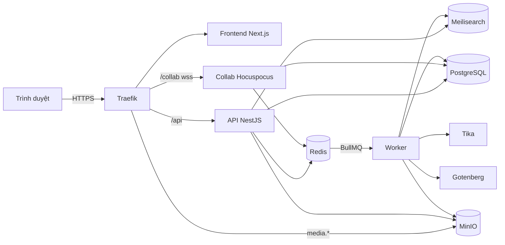
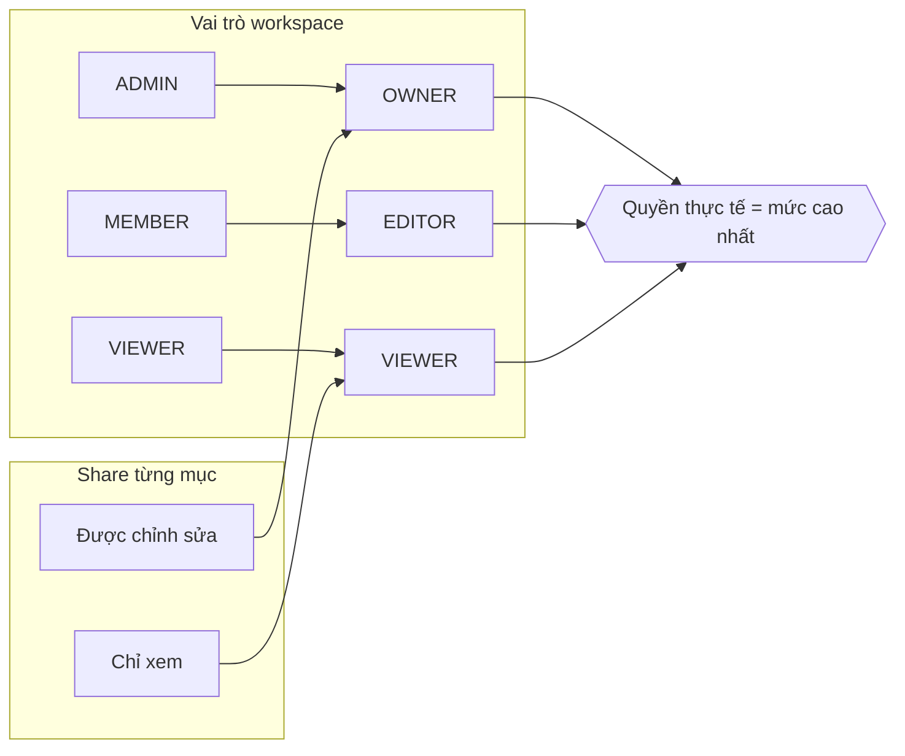
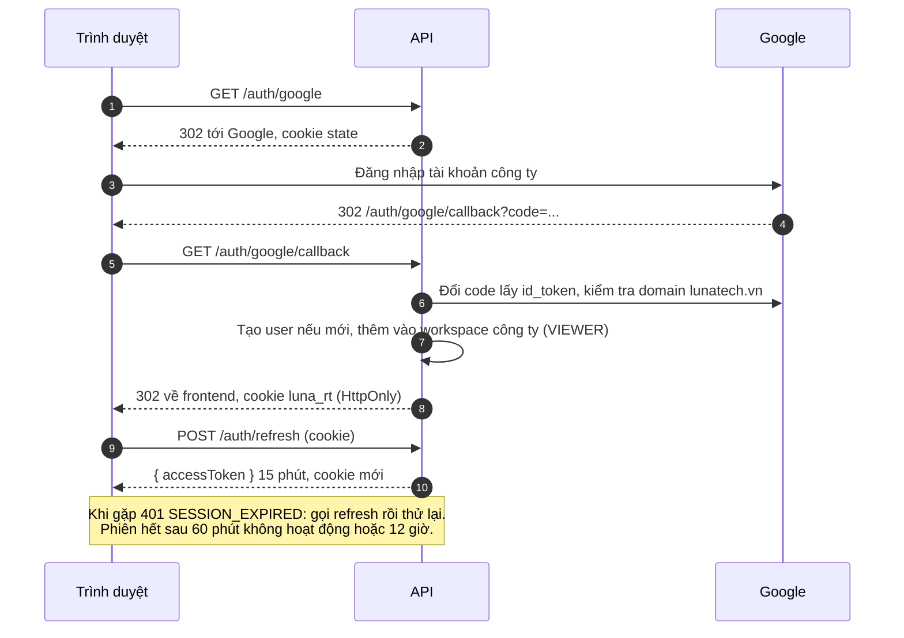
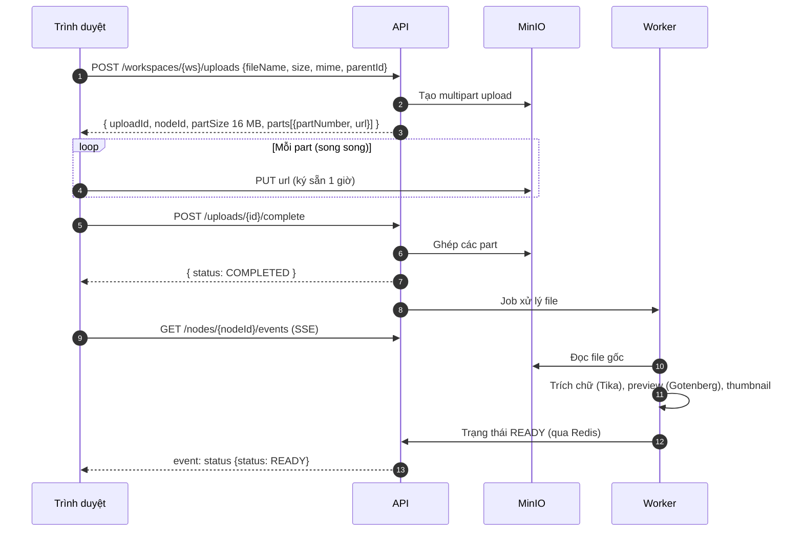
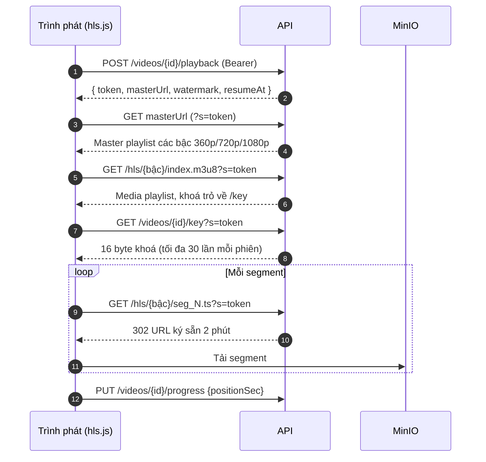
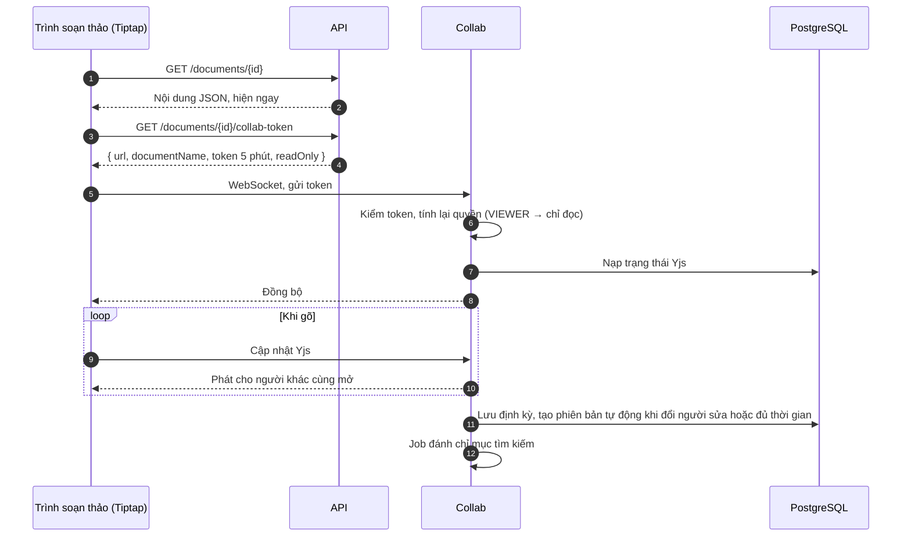
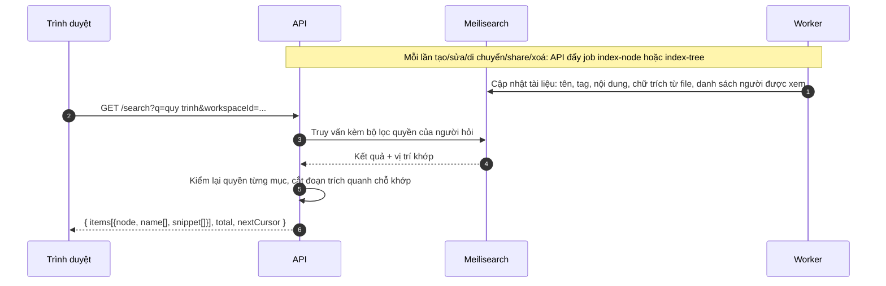
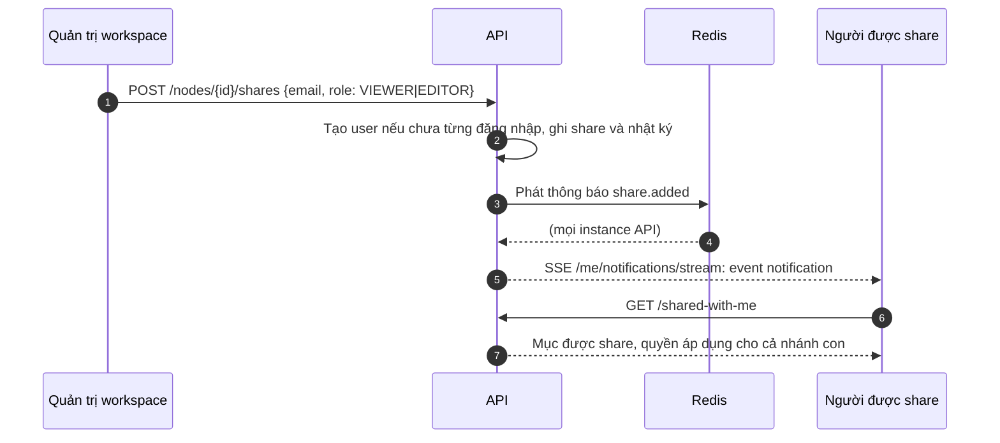

# Luna Knowledge API: tổng quan

Tài liệu cho người tích hợp với API (frontend, công cụ nội bộ) và cho buổi trình bày hệ thống. Chi tiết từng endpoint xem Swagger; tài liệu này giải thích các luồng nghiệp vụ và cách các thành phần phối hợp.

| Tài liệu | Ở đâu |
|---|---|
| Swagger UI | `http://localhost:4000/api/docs` (dev); production bật bằng `SWAGGER_ENABLED=true` |
| OpenAPI JSON | `/api/docs-json`, nhập được vào Postman, Bruno, Insomnia |
| Bộ request theo luồng | `backend/tests/flows.http`, chạy `pnpm test:flows` |
| Bộ kiểm thử đầy đủ | `backend/tests/[0-9]*.http`, chạy `pnpm test:http` |
| Đặc tả | `docs/SPEC.md` |

## 1. Thành phần

- **API**: mọi nghiệp vụ, kiểm quyền, ghi nhật ký. Không giữ file lớn: upload và tải video đi thẳng giữa trình duyệt và MinIO qua URL ký sẵn.
- **Collab**: đồng bộ tài liệu soạn thảo theo thời gian thực (Yjs), tự lưu và tạo phiên bản.
- **Worker**: việc nặng chạy nền: trích chữ (Tika), tạo preview PDF (Gotenberg), thumbnail, transcode video HLS, đánh chỉ mục tìm kiếm.

## 2. Quy ước chung

- Base URL `/api/v1`. ID là UUID, thời gian là ISO 8601 UTC.
- Xác thực: `Authorization: Bearer <accessToken>`.
- Lỗi luôn có dạng `{ "error": { "code", "message", "details?", "requestId" } }`. Khi báo lỗi, gửi kèm `requestId` (cũng có ở header `x-request-id`).

| HTTP | `code` | Khi nào |
|---|---|---|
| 400 | `VALIDATION_ERROR` | Body/query sai; `details` liệt kê từng trường |
| 401 | `UNAUTHENTICATED`, `SESSION_EXPIRED` | Thiếu token, token hết hạn, phiên bị thu hồi |
| 403 | `FORBIDDEN` | Thấy được mục nhưng không đủ quyền thao tác |
| 404 | `NOT_FOUND` | Không tồn tại, đã xoá, **hoặc không có quyền xem** (không lộ sự tồn tại) |
| 409 | `CONFLICT` | Trùng tên trong cùng thư mục, trùng slug |
| 413 | `TOO_LARGE` | Body > 512 KB, file vượt giới hạn |
| 415 | `UNSUPPORTED_TYPE` | Đuôi file không được phép |
| 429 | `RATE_LIMITED` | Vượt 600 request/phút (người dùng) hoặc 120/phút (IP chưa đăng nhập); xem `Retry-After` |

- Phân trang: gửi `limit` và `cursor`, nhận `{ items, nextCursor }`. Hết dữ liệu khi `nextCursor` là `null`.
- Xoá là xoá mềm: mục vào thùng rác cùng cả nhánh, khôi phục được cho tới khi quản trị dọn.

## 3. Phân quyền

Mỗi tài khoản `@lunatech.vn` tự động là **VIEWER** của workspace công ty *LunaTech* ngay lần đăng nhập đầu. Nội dung công ty do System Admin và những người được giao vai trò MEMBER/ADMIN đăng. Ai cũng tạo được workspace nhóm và là ADMIN của nó.

| Quyền nội dung | Được làm |
|---|---|
| VIEWER | Xem, tải, comment, tìm kiếm |
| EDITOR | + tạo, sửa, upload, di chuyển, xoá vào thùng rác, tạo tag |
| OWNER | + share, xem hoạt động, xoá vĩnh viễn, sửa/xoá tag, quản lý thành viên |

Workspace luôn phải còn ít nhất một ADMIN. Mọi thao tác thay đổi đều ghi `audit_logs`; System Admin xem và xuất CSV ở `/admin/audit-logs`.

## 4. Đăng nhập

Refresh token xoay vòng mỗi lần dùng; dùng lại token cũ sẽ thu hồi cả phiên (chống đánh cắp cookie). Lỗi đăng nhập trả về frontend qua `?error=` (`DOMAIN_NOT_ALLOWED`, `ACCOUNT_DISABLED`…).

## 5. Upload file

- Rớt mạng giữa chừng: `GET /uploads/{id}` trả các part đã nhận, `GET /uploads/{id}/parts` lấy URL mới cho phần còn thiếu. Upload chưa hoàn tất bị huỷ sau 24 giờ.
- Tải phiên bản mới cho file có sẵn: gửi `replaceNodeId` thay vì `parentId`.
- Tải về: `GET /files/{id}/download` (stream qua API, có ghi nhật ký) hoặc `POST /files/{id}/download-link` lấy link dùng một lần trong 60 giây.

## 6. Xem video

Video được transcode sang HLS nhiều bậc chất lượng, mã hoá AES-128. File gốc chỉ System Admin tải được.

Phiên xem hết hạn sau 15 phút không dùng, tối đa 8 giờ. Watermark (email người xem) hiển thị chồng lên video.

## 7. Soạn tài liệu cùng nhau

- Phiên bản: `POST /documents/{id}/versions` lưu bản có tên; `GET .../versions/{vid}/diff` so sánh theo từ; `POST .../restore` khôi phục (collab đẩy nội dung cũ tới mọi người đang mở).
- Comment: `POST /documents/{id}/threads` với `mentions` để @nhắc; người được nhắc nhận thông báo.
- Ảnh nhúng: `POST /documents/{id}/assets`. Xuất: `GET /documents/{id}/export?format=html|md`. Import Word: `POST /files/{id}/convert-to-document`.

## 8. Tìm kiếm

Gõ không dấu vẫn tìm được có dấu ("quy trinh" khớp "Quy trình"); kết quả trả về các đoạn `{text, match}` để tô sáng. Chỉ mục được dựng lại lúc 03:30 hằng đêm, hoặc System Admin gọi `POST /admin/search/reindex`.

## 9. Chia sẻ và thông báo

Các loại thông báo: `share.added`, `comment.new`, `comment.mention`, `video.ready`, `video.failed`. Danh sách ở `GET /me/notifications`, đánh dấu đã đọc bằng `POST /me/notifications/read`.

## 10. Vận hành

- `GET /health` (Postgres, Redis, MinIO) và `GET /health/live` cho Docker/Traefik.
- `/metrics` (Prometheus) ở API, collab và worker; chỉ mở trong mạng nội bộ hoặc kèm `METRICS_TOKEN`.
- Kết quả tải thử: 200 người dùng đồng thời, thao tác thường p95 49 ms, tìm kiếm p95 62 ms; 20 người cùng sửa một tài liệu, độ trễ đồng bộ p95 2 ms.
- Triển khai, backup, khôi phục: `docs/DEPLOY.md`.
